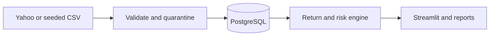
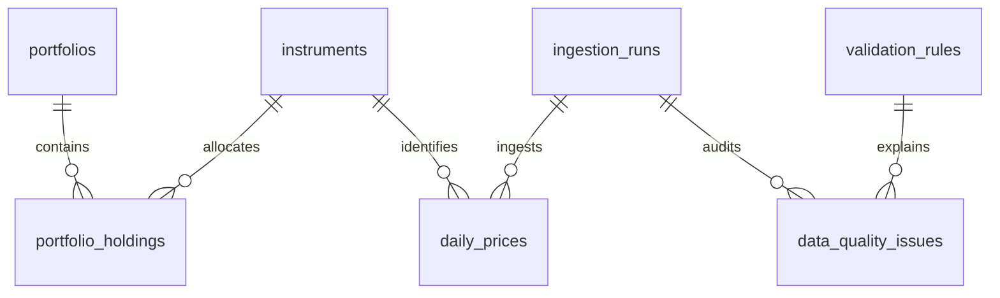

# Market Data Quality & Portfolio Risk Monitor

A reproducible analyst workspace for identifying unreliable daily prices and evaluating
instrument and long-only portfolio risk. Built for explaining the full technical product
analyst workflow: acquire evidence, validate it, compute defensible metrics and communicate
limitations. Bundled prices are **synthetic demonstration data**, not market history.

## Quick start (no paid service)

Python 3.12+:

```bash
python -m venv .venv
# Windows: .venv\Scripts\activate
# macOS/Linux: source .venv/bin/activate
pip install -e '.[dev]'
alembic upgrade head
python -m market.ingestion
streamlit run app/dashboard.py
```

Open http://localhost:8501. Local mode uses SQLite (`market.db`) for a quick offline demo.
PostgreSQL is the deployment database. Run the entire PostgreSQL stack with:

```bash
docker compose up --build
```

Compose persists data in a named volume and waits for `pg_isready`. Its database is exposed
only on localhost:5433; Streamlit uses localhost:8501. Set `POSTGRES_PASSWORD` in an untracked
`.env` for a non-demo installation. Avoid reserved URL characters in the password or percent
encode them. `docker compose down` preserves data. The app migrates and idempotently loads
sample data on startup. The sample interval is January 2–December 31, 2024.

## Features and architecture

- NYSE session calendar; schema, duplicate, OHLC, price, volume and session validation.
- Quarantined hard failures; informational missing-session, stale, flat-price and jump warnings.
- Audit runs, raw issue evidence, atomic batches and source-separated upserts.
- Returns, annualized risk, drawdown, historical VaR, correlations and daily-rebalanced portfolios.
- Five SQL-backed sections, interactive date/source/instrument/weight controls, CSV and HTML reports.
- Python, PostgreSQL, SQLAlchemy, Alembic, Pandas, NumPy, Plotly, Streamlit, Pytest and Ruff.





`src/market` separates ingestion, validation, persistence, analytics, read services and reporting.
See [architecture](docs/architecture.md), [data model](docs/data_model.md),
[formulas](docs/analytics.md), [demo walkthrough](docs/demo_walkthrough.md) and
[interview guide](docs/interview_guide.md). Portfolios are computed interactively; portfolio and
holding tables reserve a constrained schema for future saved configurations.

## Data provenance and live ingestion

`data/samples/prices.csv` is reproducibly generated by `market.ingestion.sample(seed=42)`.
It uses shared and instrument-specific log returns on NYSE sessions; no real performance claims
are implied. To regenerate: `python -c "from market.ingestion import sample; sample().to_csv('data/samples/prices.csv', index=False)"`.

```bash
python -m market.ingestion --source yahoo --symbols SPY QQQ AAPL MSFT IWM --start 2024-01-02 --end 2024-12-31
```

[Yahoo access through yfinance](https://ranaroussi.github.io/yfinance/) is unofficial,
rate-limited and intended for personal research/educational use; review Yahoo terms before
using or redistributing data. We do not bundle Yahoo downloads. `auto_adjust=True` explicitly
adjusts OHLC for splits/dividends. Adjustments are provider estimates and may be revised.
Never compare these as raw execution prices. Unadjusted closes can generate artificial returns
at splits or omit dividends. Volume is provider-reported and not transformed by this app.
Retries use bounded exponential backoff; empty/malformed responses create a failed audited run
or quarantined records. Failures never silently switch to synthetic data.

## Analytics conventions

Daily simple return is `P[t]/P[t-1]-1`; cumulative wealth is `product(1+r)`;
annualized return is `wealth^(252/n)-1`. Sample standard deviation uses `ddof=1`;
annualized volatility multiplies it by `sqrt(252)`. Drawdown includes initial wealth 1.
Historical daily 95% VaR is `-quantile(r, .05)`, linearly interpolated and signed
(it can be negative in all-positive samples). Portfolios rebalance to user weights every session,
exclude fees/taxes, use USD and require nonnegative weights summing to 1. Risk contributions
sum to annualized portfolio volatility. Benchmark-relative return is terminal return difference
in percentage points, not alpha. Internal missing sessions block compounding; prices are never
forward-filled. At least three price observations are needed for summary metrics.

## Configuration and verification

`DATABASE_URL`: optional SQLAlchemy URL; default `sqlite:///market.db`.
`TEST_DATABASE_URL`: optional **disposable** PostgreSQL database used by integration tests;
tests create/drop application tables there, so never point it at a valuable database.

```bash
ruff check .
ruff format --check .
pytest --cov --cov-report=term-missing --cov-fail-under=80
alembic upgrade head
```

Coverage targets core analytics and validation, including their input guards; UI/ORM/provider
coverage is excluded from that denominator and tested separately. CI runs lint, tests and
PostgreSQL migration/integration checks. Actual local and CI evidence belongs in
[verification](docs/verification.md); configured CI is not proof of a successful run.

## Limitations and next steps

Historical metrics do not forecast risk. Small samples and non-normal heavy-tailed returns limit
VaR interpretation. The calendar uses current library definitions of NYSE sessions for the US
instruments; symbol-specific suspensions are not modeled. Freshness is evaluated against the
requested final session, while UI also shows the actual latest observation date. Source audits
show all historical runs; issue counts can include repeated warnings from successive runs.
Concurrent ingestion is designed for one worker; database constraints/upserts protect prices,
but instrument/rule creation is not a multi-writer coordination system. Initial migration uses
ORM metadata frozen at release 1; future changes must use explicit Alembic operations.
Planned additions: saved portfolios, licensed providers, performance attribution and transaction costs.
