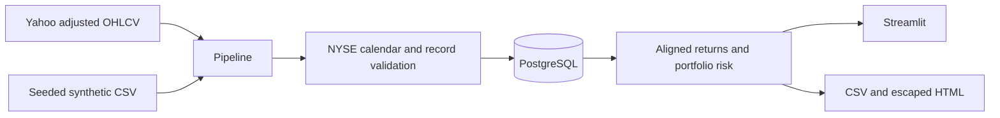

# Architecture and implementation milestones

The modular monolith keeps provider access, validation, persistence, quantitative
analytics, reporting and Streamlit presentation separate. PostgreSQL is the production
database; SQLite is supported for offline development and fast integration tests.

1. Foundation: packaging, ORM constraints, reversible Alembic migration.
2. Pipeline: deterministic sample, retried provider fetch, quarantine, audit runs.
3. Analytics: hand-checked returns, risk, alignment and risk contributions.
4. Presentation: five dashboard sections, inputs, CSV and HTML export.
5. Verification: unit/integration/UI tests, coverage, PostgreSQL and Compose smoke.
6. Documentation and publication after checks pass.

Acceptance tests cover NYSE holidays, injected defects, rerun idempotency,
failed-run recording, portfolio edge cases, migration upgrade/downgrade, report
escaping, and every dashboard section. Raw rejected payloads stay in issues.
Hard failures prevent a record entering prices; warnings retain observations.
